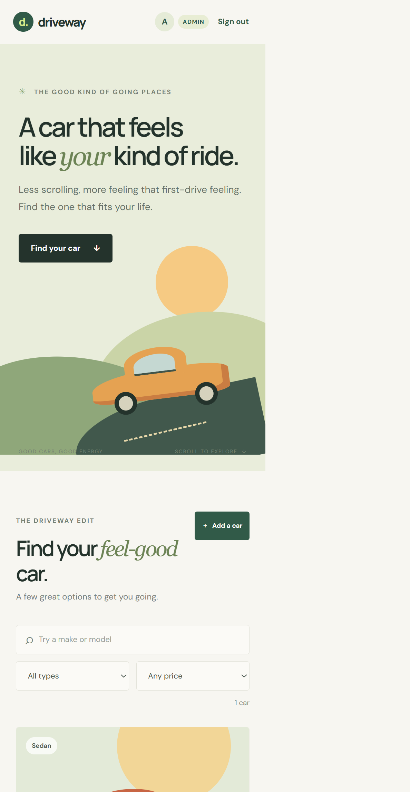

# Driveway — Car Dealership Inventory

Driveway is a responsive, full-stack dealership inventory app. Customers can register, browse and filter a car catalogue, and purchase in-stock vehicles. Administrators can add, edit, restock, and remove inventory. The backend is a FastAPI REST API backed by persistent SQLite, and the single-page interface is React, TypeScript, and Tailwind CSS.

## Features

- Email/password registration and login with signed, expiring JWT bearer tokens.
- PBKDF2-SHA256 password hashing; passwords are never stored in plain text.
- Protected vehicle list, make/model/category/price filters, create and update operations.
- Atomic stock decrement when a purchase succeeds; attempts to buy out-of-stock cars receive a `409 Conflict`.
- Admin-only restocking and deletion. Public registration always creates a standard user.
- Responsive React catalogue with search, filters, inventory controls, empty/loading/error states, and disabled purchase buttons for sold-out vehicles.
- SQLite data persists in `backend/dealership.db` by default. A different SQLAlchemy database URL can be configured through `DATABASE_URL`.

## Requirements

- Python 3.10 or later
- Node.js 20.19 or later (or 22.12 or later) and npm

## Run locally

### 1. Start the API

From the repository root:

```powershell
cd backend
python -m venv .venv
.\.venv\Scripts\Activate.ps1
python -m pip install -r requirements.txt
Copy-Item .env.example .env
uvicorn app.main:app --reload
```

The API listens on `http://localhost:8000`. Interactive endpoint documentation is available at `http://localhost:8000/docs`; `http://localhost:8000/api/health` is the health check.

The example environment file creates an initial administrator:

- Email: `admin@example.com`
- Password: `AdminPass123!`

Change the example credentials and `JWT_SECRET` in `backend/.env` before using the app beyond local development. The API loads this `.env` file on startup. To use another persistent database, set `DATABASE_URL` to a SQLAlchemy URL supported by the installed database driver.

### 2. Start the SPA

In a second terminal, from the repository root:

```powershell
cd frontend
npm install
npm run dev
```

Open the Vite URL shown in the terminal (normally `http://localhost:5173`). The frontend defaults to `http://localhost:8000` for the API. To use a different API origin, create `frontend/.env` with:

```text
VITE_API_URL=http://localhost:8000
```

Register a customer account to browse and purchase. Sign in with the seeded administrator account to add, update, restock, or delete vehicles.

### 3. Production frontend build

```powershell
cd frontend
npm run build
```

The compiled SPA is written to `frontend/dist`. Serve it with any static hosting provider and configure `VITE_API_URL` at build time. Set `CORS_ORIGINS` on the API to the deployed frontend origin(s).

### Use the VS Code tasks

Open the workspace and run either task from **Terminal → Run Task**:

- `API: Run FastAPI`
- `Web: Run React`

The workspace recommends the Python and Pylance extensions; TypeScript and React editing support is built into VS Code.

## API overview

All vehicle endpoints require an `Authorization: Bearer <token>` header. Register and login are public.

| Method | Endpoint | Access |
| --- | --- | --- |
| `POST` | `/api/auth/register` | Public |
| `POST` | `/api/auth/login` | Public |
| `GET` | `/api/vehicles` | Authenticated |
| `GET` | `/api/vehicles/search?q=&make=&model=&category=&min_price=&max_price=` | Authenticated |
| `POST` | `/api/vehicles` | Authenticated |
| `PUT` | `/api/vehicles/{id}` | Authenticated |
| `DELETE` | `/api/vehicles/{id}` | Admin |
| `POST` | `/api/vehicles/{id}/purchase` | Authenticated |
| `POST` | `/api/vehicles/{id}/restock` | Admin |

Vehicle payloads include `make`, `model`, `category`, positive `price`, and non-negative `quantity`. The backend validates inputs and returns explicit `401`, `403`, `404`, and `409` responses for authentication, authorization, missing records, and stock conflicts.

## Tests and build

Run the backend tests from the repository root:

```powershell
python -m pytest -q
```

Run the frontend TypeScript check and production bundler:

```powershell
cd frontend
npm run build
```

See [TEST_REPORT.md](./TEST_REPORT.md) for the recorded verification results.

## Screenshots

The screenshot below shows the responsive inventory view with an administrator account and a sample vehicle:



## My AI Usage

I used the AI assistant in Copilot in VS Code to interpret the kata requirements, create the initial API tests before implementing the routes, scaffold the FastAPI and React application, and help check edge cases and setup instructions. I reviewed and adjusted the generated code and test expectations during implementation. The AI helped accelerate boilerplate and coverage of the endpoint workflow; running the tests exposed a missing authorization header in a test, which was corrected before final verification. I used the API test suite and frontend production build as verification rather than relying on generated code alone.

The public source repository is [github.com/23f2004904/driveway-car-dealership-inventory](https://github.com/23f2004904/driveway-car-dealership-inventory). The local Git history includes a test-first API contract commit followed by implementation commits; AI-assisted commits carry the required Copilot co-author trailer. No live deployment has been created.

## Repository status / kata deliverables

- Source, setup instructions, API, frontend, backend tests, and an application screenshot are included in this workspace.
- Raw request text supplied for this implementation is recorded in [PROMPTS.md](./PROMPTS.md).
- The public repository and local screenshots are included; a live deployment URL is not available.
